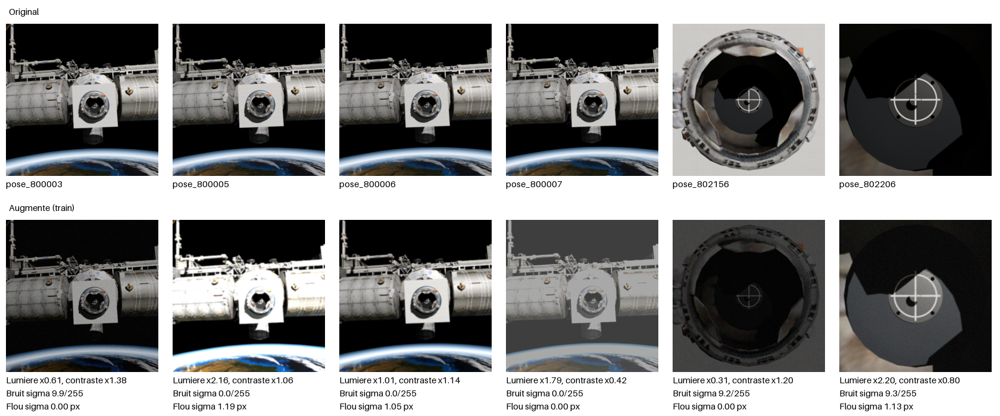

# AI Estimation for Autonomous Space Docking

**Public beta**

  

*An Orion-class capsule docks to a station port. A CNN looks at the onboard camera, a Kalman filter
cleans up its estimates, and a Simulink pilot flies the approach. The demo is sped up 12×:
**[watch the full real-time video on YouTube](https://youtu.be/DaG68fl6lts)** (or [download the 720p version](media/docking_demo_720p.mp4)).*

<h1 align="center">Features</h1>

I wanted to see how far a single camera and a neural network could go at one of the hardest parts of
spaceflight: the last ten metres of a docking. No lidar, no retro-reflectors, just pixels.

  

1. **Synthetic data.** Blender renders the docking port from random camera poses, plus whole approach
   sequences flown by the simulator itself.
2. **Perception.** A CNN finds keypoints on the docking port, and a PnP solver turns them into a
   6-DOF relative pose.
3. **Estimation.** The vision runs at 2 Hz and is noisy. A Kalman filter fuses it with the commanded
   thrust and the orbital dynamics. When the target gets too close to see, it keeps flying on its
   estimate.
4. **Guidance & control.** The pilot keeps an approach corridor, slows down near the port and aligns
   the attitude before moving forward.
5. **Closing the loop.** Blender renders the camera view at every control step, and the actual
   network steers the vehicle.

<h2 align="center">Dataset & training</h2>

This project uses Blender to generate the dataset: 1,000+ images rendered from different positions
and angles. During training, the images are augmented with noise, blur, exposure changes and more.

  

  
  

## Roadmap

- [ ] **v1.0**: release the perception core, the full Kalman pilot and the CNN-in-the-loop bridge
- [ ] Increase the number of simulations (to cover worst-case scenarios)
- [ ] Increase the CNN frequency
- [ ] Hardware-in-the-loop with a real camera

## References & credits

- D. Rondao, L. He, N. Aouf, *AI-based monocular pose estimation for autonomous space refuelling*,
  Acta Astronautica 220 (2024) 126–140, [doi:10.1016/j.actaastro.2024.04.003](https://doi.org/10.1016/j.actaastro.2024.04.003).
  It was a big inspiration for the simulator-to-Blender sequence pipeline.
- Orion capsule 3D model: **NASA** ([3D Resources](https://science.nasa.gov/3d-resources/orion-capsule/)).
  It is not redistributed here, and its use implies no endorsement by NASA.

## License

The code in this repository is released under the [MIT License](LICENSE).
