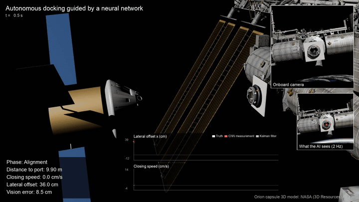
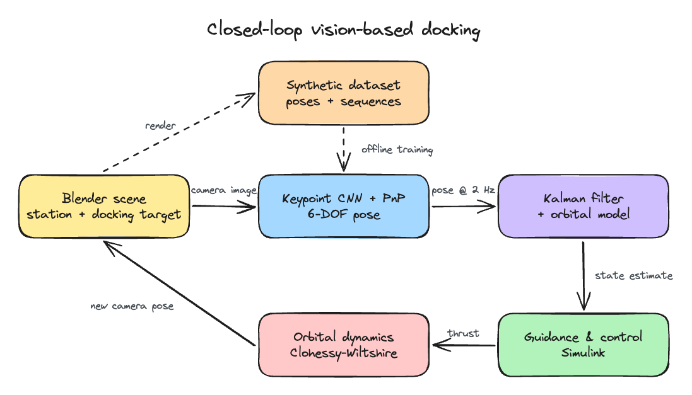
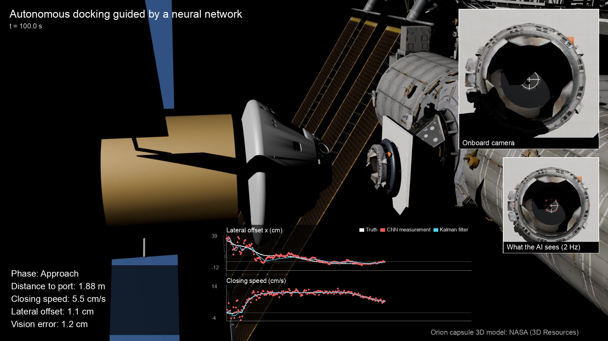
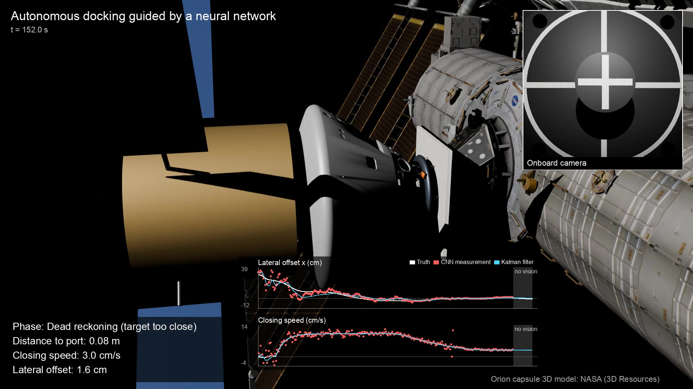

# AI Estimation for Autonomous Space Docking

> **Public beta.** This repo holds the simulation and video tooling of a bigger side project. The
> perception core (synthetic dataset pipeline, keypoint network, trained weights, CNN-in-the-loop
> bridge) and the full Kalman-filtered pilot stay private for now. They'll be released with **v1.0**,
> once the project is finished. Until then, expect rough edges: this is very much a work in progress.

*An Orion-class capsule docks to a station port. A CNN looks at the onboard camera, a Kalman filter
cleans up its estimates, and a Simulink pilot flies the approach. The demo is sped up 12×;
[watch the real-time 720p version](media/docking_demo_720p.mp4).*

## What's this?

I wanted to see how far a single camera and a neural network could go at one of the hardest parts of
spaceflight: the last ten metres of a docking. No lidar, no retro-reflectors, just pixels.

1. **Synthetic data.** Blender renders the docking port from random camera poses, plus whole approach
   sequences flown by the simulator itself.
2. **Perception.** A CNN finds keypoints on the docking port, and a PnP solver turns them into a
   6-DOF relative pose.
3. **Estimation.** The vision runs at 2 Hz and is noisy. A Kalman filter fuses it with the commanded
   thrust and the orbital dynamics. When the target gets too close to see, it keeps flying on its
   estimate.
4. **Guidance & control.** The pilot keeps an approach corridor, slows down near the port and aligns
   the attitude before moving forward.
5. **Closing the loop.** Blender renders the camera view at every control step, and the actual
   network steers the vehicle.

The diagram is an [Excalidraw](https://excalidraw.com) file ([`media/pipeline.excalidraw`](media/pipeline.excalidraw)):
open it there to tweak it.

## Dataset & training

Rough numbers, the details come with v1.0:

- **A few thousand synthetic images** (~4k renders, more with augmentation), covering the approach
  from about 10 m down to half a metre.
- **Full approach sequences** flown in closed loop by the simulator and rendered frame by frame, so
  the test set has trajectories the model has never seen.
- **Photometric augmentation**: noise, blur, exposure and contrast.
- **Splits by whole sequences.** The test set stayed untouched until the very end.
- **About ten training runs so far**, from a small baseline CNN to the current keypoint model.

  
  

## Roadmap

- [ ] **v1.0**: release the perception core, the full Kalman pilot and the CNN-in-the-loop bridge
- [ ] Domain randomisation (procedural backgrounds, sun angles) and R-bar approaches
- [ ] Thruster-level actuation and sensor latency
- [ ] Hardware-in-the-loop with a real camera

## References & credits

- D. Rondao, L. He, N. Aouf, *AI-based monocular pose estimation for autonomous space refuelling*,
  Acta Astronautica 220 (2024) 126–140, [doi:10.1016/j.actaastro.2024.04.003](https://doi.org/10.1016/j.actaastro.2024.04.003).
  It was a big inspiration for the simulator-to-Blender sequence pipeline.
- Orion capsule 3D model: **NASA** ([3D Resources](https://science.nasa.gov/3d-resources/orion-capsule/)).
  It is not redistributed here, and its use implies no endorsement by NASA.

## License

The code in this repository is released under the [MIT License](LICENSE).
