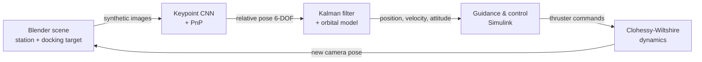

# AI Estimation for Autonomous Space Docking

> **Public beta.** This repo holds the simulation and video tooling of a bigger side project. The
> perception core (synthetic dataset pipeline, keypoint network, trained weights, CNN-in-the-loop
> bridge) and the full Kalman-filtered pilot stay private for now. They'll be released with **v1.0**,
> once the project is finished. Until then, expect rough edges: this is very much a work in progress.


*An Orion-class capsule docks to a station port. A CNN looks at the onboard camera, a Kalman filter
cleans up its estimates, and a Simulink pilot flies the approach. The demo is sped up 8×;
[watch the real-time 720p version](media/docking_demo_720p.mp4).*

## What's this?

I wanted to see how far a single camera and a neural network could go at one of the hardest parts of
spaceflight: the last ten metres of a docking. No lidar, no retro-reflectors, just pixels.

The pipeline looks like this:



1. **Synthetic data.** Blender renders the docking port from thousands of random camera poses, plus
   whole approach sequences flown by the simulator itself. The idea of sequences generated by the
   simulator and rendered in Blender comes from Rondao et al. (see references).
2. **Perception.** A ResNet-based network finds 11 keypoints: 6 on the docking ring for far range and
   5 on a parallax target for the last metre. A PnP solver turns them into a 6-DOF pose.
3. **Estimation.** The pose comes in at 2 Hz and is noisy. A Kalman filter fuses it with the
   commanded thrust and the orbital dynamics to get smooth position, velocity and attitude. When the
   target gets too close to see, it keeps flying on its estimate.
4. **Guidance & control.** The pilot keeps an approach corridor, slows from 10 cm/s down to 3 cm/s and
   aligns the attitude before moving forward.
5. **Closing the loop.** In the full version, Blender renders the camera view at every control step
   and the actual CNN steers the vehicle.

## Results so far

| What | Result |
|---|---|
| Perception on held-out test **sequences** (never seen in training) | **0.7–0.9 cm** mean position error (**0.19 %** of range), **0.3–0.4°** attitude |
| Frames within the classic final-approach rule of thumb (1 % of range, 1°) | **98–99.6 %** |
| Closed loop, Monte Carlo with the vision error model + full Kalman pilot | **20 / 20** docks, 0.17 cm lateral error, 0.2° at contact, Δv 0.25 m/s |
| Closed loop with the **real CNN in the loop** (Blender render at every step) | **Docked**: 1.5 cm lateral error, 1.3°, 3 cm/s |
| Baseline pilot shipped in this repo (no Kalman filter), vision error model | 6 / 10 docks, up to 5.6° at contact, Δv 3.1 m/s |

The last row is the reason the Kalman filter exists. Differentiating noisy vision measurements makes
the thrusters chatter, and it shows (Δv ×12).

<p align="center">
  
  
</p>

## What's in this repo

```
simulink/                      MATLAB / Simulink, builds and runs the closed loop
  build_docking_model.m        generates docking_model.slx from scratch (no hand-edited .slx)
  run_docking_sim.m            flies one or many approaches, scores the contact, plots, exports
  docking_params.m             every assumption and tuning knob in one place
  docking_dynamics.m           relative 6-DOF motion + Clohessy-Wiltshire orbital terms
  docking_sensor.m             true pose, or a statistical model of the CNN error vs distance
  docking_controller.m         BASELINE pilot (PD + finite differences), the Kalman pilot comes in v1.0
  cnn_sensor.m                 placeholder for the CNN-in-the-loop sensor (v1.0)
  export_video_trajectory.m    resamples a run at 30 fps for the video tools
  cw_acceleration.m, quat_to_rotm.m, rotvec_to_rotm.m, read_logged_series.m
video/
  render_video.py              Blender/EEVEE: onboard camera + chase camera, Orion capsule
  compose_video.py             HUD, telemetry, live Kalman graphs, "what the AI sees" inset -> MP4
media/                         demo GIF, stills, 720p video, baseline plot
```

## Quick start

**Simulation** (MATLAB R2024b or newer with Simulink; tested on R2026b. MATLAB Function blocks need a
C compiler, e.g. Xcode Command Line Tools on macOS):

```matlab
cd simulink
r = run_docking_sim(1, 0);       % one approach with a perfect sensor
r = run_docking_sim(1:20, 1);    % Monte Carlo with the vision error model (baseline pilot)
```

You get a success summary, a plot (`docking_*.png`) and a 30 fps trajectory for the video tools.

**Video** (Blender 4.2+ with EEVEE, Python 3 with numpy, pandas and pillow, plus ffmpeg). You need
your own Blender scene with a docking-port object; the station scene isn't part of this repo. Grab
the NASA Orion model ("no fbc" STL) from
[NASA 3D Resources](https://science.nasa.gov/3d-resources/orion-capsule/).

```bash
DOCKING_PORT_OBJECT=YourPort ORION_STL=assets/orion_capsule_no_fbc.stl \
  blender -b your_scene.blend --python video/render_video.py -- simulink/video_trajectory_truth.csv renders 2
python video/compose_video.py --trajectory simulink/video_trajectory_truth.csv --renders renders \
  --output docking.mp4 --lang en
```

Every on-screen string sits in one dictionary, so a new language is a re-compose away. No re-render
needed.

## Conventions

- **Port frame**: origin on the docking ring, +Z pointing out of the port.
- **Camera frame**: OpenCV style (X right, Y down, Z forward), on the chaser's docking axis.
- **Pose**: `X_camera = R_camera_from_port · X_port + t_camera_from_port`.
- **Orbit**: the port is fixed in the LVLH frame of a circular, ISS-like orbit, with the approach
  along +V-bar.

## Roadmap

- [ ] **v1.0**: release the perception core, the full Kalman pilot and the CNN-in-the-loop bridge
- [ ] Domain randomisation (procedural backgrounds, sun angles) and R-bar approaches
- [ ] Thruster-level actuation and sensor latency
- [ ] Hardware-in-the-loop with a real camera

## References & credits

- D. Rondao, L. He, N. Aouf, *AI-based monocular pose estimation for autonomous space refuelling*,
  Acta Astronautica 220 (2024) 126–140, [doi:10.1016/j.actaastro.2024.04.003](https://doi.org/10.1016/j.actaastro.2024.04.003).
  It was a big inspiration for the simulator-to-Blender sequence pipeline.
- Orion capsule 3D model: **NASA** ([3D Resources](https://science.nasa.gov/3d-resources/orion-capsule/)).
  It is not redistributed here, and its use implies no endorsement by NASA.

## License

The code in this repository is released under the [MIT License](LICENSE).
